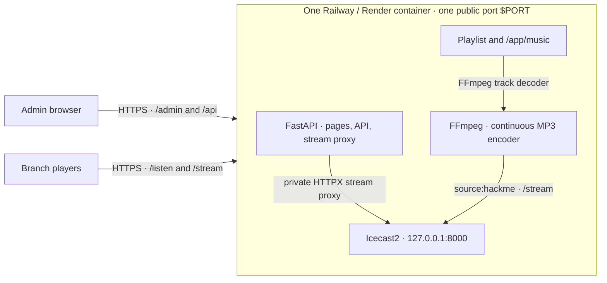

# Ghammas Baladi Radio — CDR Group

## System overview and tech stack

Ghammas Baladi Radio is a centralized live MP3 station. A single container runs FastAPI, Icecast2 and FFmpeg. Icecast accepts one private source on loopback; FastAPI is the only public HTTP listener and serves the pages, JSON API and proxied audio. Every branch connects to the same `/stream` URL and joins the same live source timeline.

The audio controller decodes the current MP3 to stereo 44.1 kHz PCM and writes it into one long-running FFmpeg MP3 encoder. That encoder keeps one source connection open to Icecast as the queue advances. Playlist edits take effect on the next track boundary; Skip terminates the active decoder and advances immediately. Listeners remain connected to Icecast through these changes.

**Stack:** Python 3.12, FastAPI, Uvicorn, HTTPX, Icecast2 and FFmpeg. The responsive player and studio are plain HTML, CSS and JavaScript. At least three distinct royalty-free MP3 tracks and the initial playlist are baked into the Docker image during build. User-provided MP3s in `demo_music/` take priority; missing slots are filled with verified Wikimedia Commons CC0 recordings, with original synthesized tracks as the offline build fallback. Sources include [Bach Cello Suite No. 1 Prelude](https://commons.wikimedia.org/wiki/File:Bach_Cello_Suite_1_Prelude_(BWV_1007)_Played_by_Chris.ogg), [Mozart Piano Sonata No. 14](https://commons.wikimedia.org/wiki/File:Mozart_-_Piano_Sonata_No._14.ogg), and [Beethoven Pathetique Sonata, II. Adagio](https://commons.wikimedia.org/wiki/File:Beethoven,_Sonata_No._8_in_C_Minor_Pathetique,_Op._13_-_II._Adagio_cantabile.ogg); each source page identifies the audio as CC0.

## Cloud architecture

The container binds only FastAPI to `0.0.0.0:$PORT` (`8080` when unset). Icecast binds `127.0.0.1:8000` and is not a public service. The hosting platform terminates HTTPS at its edge; browser audio uses the same-origin secure `/stream` route. Initial royalty-free tracks and `playlist.json` are baked into the image, so cold starts on ephemeral PaaS storage have audio ready without a first-run download. For production libraries and durable uploads, use persistent object storage such as AWS S3 or Cloudflare R2.

## Deploy

Build from this directory with the included `Dockerfile`; Railway and Render should use the container/Dockerfile deployment path. No compose file or second service is required. The image build installs Python, pip, Icecast2 and FFmpeg, generates the demo MP3s and seeds `playlist.json`. Container startup fixes the Icecast log/runtime directory ownership, starts Icecast, waits for its loopback socket and then starts the FastAPI process on `$PORT`.

Configure these application environment variables in the PaaS dashboard:

| Variable | Default | Purpose |
| --- | --- | --- |
| `PORT` | `8080` | Public FastAPI port assigned by the platform |
| `ADMIN_USER` | `admin` | HTTP Basic admin username |
| `ADMIN_PASSWORD` | `cdr2026` | HTTP Basic admin password; set a unique secret before public use |

The Icecast source uses the requested internal `source:hackme` credentials. It is loopback-only and not exposed through FastAPI. Do not add a public route for Icecast's administration interface.

**Uploaded files and free tiers:** Initial baked-in tracks survive container replacement because they are part of the image. Later admin uploads and playlist edits live in `/app/music` and `/app/playlist.json` by default and are ephemeral on filesystems replaced during restart or redeploy. For durable production uploads, use persistent object storage such as AWS S3 or Cloudflare R2 (or a PaaS persistent volume). Some free plans may sleep or restart workloads; continuous live radio requires an always-running instance. The application uses one process/container but cannot override platform sleep policies.

## Central operations and management

- Branches open the public `/listen` page. Press **Play** once to satisfy browser autoplay rules. Volume is local to that browser; the program content and live position come from the central stream.
- Operations staff open `/admin`. The dashboard asks for `ADMIN_USER` and `ADMIN_PASSWORD` and verifies credentials against a protected endpoint. The browser keeps the credentials in page memory only.
- **Add MP3 tracks:** choose one or more `.mp3` files. Uploads are appended to the active rotation. Each file is limited to 150 MB. If the sanitized filename already exists, the server selects a numbered filename instead of overwriting it.
- **Reorder:** use the up/down arrows. The server validates that the submitted order contains each current track exactly once.
- **Delete:** remove a track from the rotation and the music directory. Removing the currently playing file does not stop its already-open decoder; it will disappear from later rotations.
- **Skip:** stops the active decoder and starts the following queued title through the existing encoder. The stream connection stays in place.
- **Preview:** use the live-feed audio controls on the studio page. Status and now-playing details refresh automatically.

API summary:

| Route | Access | Behavior |
| --- | --- | --- |
| `GET /` | Public | Redirect to `/listen` |
| `GET /listen`, `GET /admin` | Public | Serve branch player and management UI |
| `GET /stream` | Public | Async, chunked HTTPX proxy to loopback Icecast |
| `GET /api/now-playing` | Public | Current title, ordered playlist and stream status |
| `POST /api/tracks/upload` | HTTP Basic | Upload and append MP3 files |
| `POST /api/tracks/reorder` | HTTP Basic | Replace queue order after validation |
| `DELETE /api/tracks/{filename}` | HTTP Basic | Remove a track from queue and disk |
| `POST /api/tracks/skip` | HTTP Basic | Advance immediately |

## Engineering challenges and solutions

### Shared timing across branches

All players consume the same central Icecast source rather than opening independent files or encoders. This prevents playlist position from drifting because each site runs its own copy. The source timeline is shared, but browser buffers and network paths can add different playback latency; internet streaming cannot promise sample-accurate simultaneous sound at physically distant speakers. Keep branch players on the same stream URL and avoid local audio copies when coordinated programming matters.

### Skip and playlist changes without listener disconnects

FFmpeg maintains a single MP3 encoder and a single source session to Icecast. The feeder changes the decoded PCM supplied to that encoder. Skipping terminates only the active track decoder; playlist changes are re-read as tracks advance. This avoids disconnecting listener sessions during ordinary queue operations.

### One public port on Railway/Render

The only externally bound service is FastAPI on the platform-provided `$PORT`. `/stream` opens a streaming HTTPX response to `127.0.0.1:8000` and yields chunks to `StreamingResponse`; the body is never read into a single in-memory buffer. No reverse-proxy sidecar, second container or additional public port is used. No-cache and anti-proxy-buffering headers are included.

### Browser recovery

The branch player responds to media `error`, `stalled`, and `waiting` events, checks periodically for a stalled stream, and retries with a fresh same-origin stream URL while playback was active. Browsers still require a user gesture to start audio, and no script can resume automatically after a browser blocks autoplay.

## AI workflow and prompt log

Use this section to record project-specific AI assistance. Remove credentials or private data from entries.

| Date | Tool/model | Prompt or task | Files changed | Human review / outcome |
| --- | --- | --- | --- | --- |
| 2026-11-25 | OpenAI Codex (GPT-6) | Build the single-container Ghammas Baladi Radio app with one public FastAPI port, loopback Icecast, continuous FFmpeg audio, playlist admin UI and deployment documentation. | Dockerfile, Python service/feeder, HTML/CSS/JS, Icecast config, demo generator and this guide | Reviewed architecture and generated files; Python, JavaScript, shell and XML syntax checks passed. Docker build and cloud stream still need to be run on a host with Docker and a deployment account. |
| YYYY-MM-DD |  |  |  |  |

### Suggested review prompts

- Review the single-container startup and confirm Icecast is loopback-only and FastAPI uses `$PORT`.
- Inspect track skip/reorder concurrency and confirm listener connections stay on the same source mount.
- Review the admin API for filename validation, authorization coverage and safe upload handling.
- Check the responsive player on mobile and desktop, including reconnect and browser autoplay behavior.

## Operational notes

This is one live radio station per container. Run a single application worker; multiple FastAPI worker processes would each start their own feeder and contend for the same Icecast mount. If horizontal scaling is introduced, separate the source/encoder ownership from stateless web/API replicas. Configure PaaS health checks against `/api/now-playing` and monitor container logs for `radio.feeder` errors. Supply licensed MP3s in `demo_music/` to bundle your preferred opening playlist; production libraries should be stored in durable object storage rather than the ephemeral container filesystem.

## Practical handoff checklist

- Public listener URL after deployment: `https://<your-service-domain>/listen`
- Direct shared audio URL: `https://<your-service-domain>/stream`
- Configure `ADMIN_USER` and a unique `ADMIN_PASSWORD` in the host's environment settings before sharing the admin link.
- Test the stream from at least two separate devices or browser sessions. Confirm both report the same current title and hear the same live program, then record the observed delay and any device/network differences.
- Check the stream after a container restart and after uploading, reordering, deleting and skipping tracks.
- Replace the URL placeholders with the deployed HTTPS address and attach the test observations when submitting the practical assessment.
